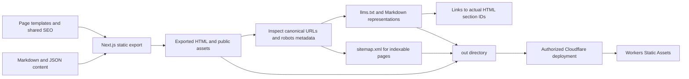
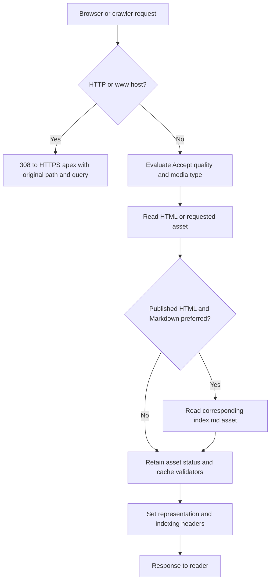

# Data flow

## Build and publication

Published HTML is the discovery authority. Invalid or duplicate canonicals fail the build. Agent exports retain original Markdown where available; other pages use their rendered main content. Selected source/PDF attribution and club-verification caveats are preserved. Generated sitemap and agent files contain no fabricated modification dates, authors, or official-association claims.

## Requests and representations

Only GET and HEAD negotiate representations. Markdown asset requests retain the reader's conditional and range headers; the preliminary HTML eligibility request omits them. HTML and Markdown use separate asset URLs and ETags, while Vary: Accept identifies the public representations. Missing Markdown falls back to HTML; missing pages remain real 404s.

Preview/search/admin/error/direct-agent responses receive HTTP noindex headers. This does not prevent authorized public reading and does not change AI-training permissions. Canonical links always point to the apex HTML resource. No crawler-identity-based facts, runtime AI service, or managed Markdown conversion is introduced.

Native Worker logs and traces remain configured in wrangler.jsonc. GitHub/Workers Builds or an authorized manual Wrangler deployment publishes the export. Search Console and Bing ownership verification remain separate account operations; local verification does not establish a production release.
